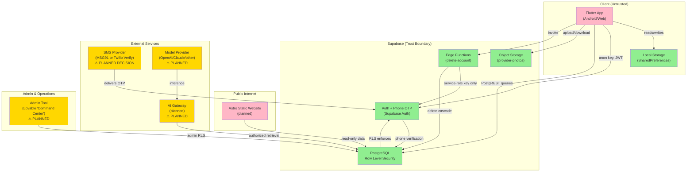

# Phase 011 Evidence — Architecture and data-flow diagram

**Status:** Done (gate passed in phase-020; human sign-off pending)  
**Objective:** Map system architecture (Flutter app, Supabase backend, planned website, AI gateway, admin tool), data flows, trust boundaries, credential storage, and account deletion cascade.

---

## System Architecture Diagram



### Architecture Legend

**Existing (Green):** Flutter app, local storage, Supabase (Auth/Postgres/Storage/delete-account function), admin access via RLS.

**Planned (Gold):** Website (Astro static), SMS provider decision, AI gateway with authorized retrieval, model provider, admin UI in Lovable.

**Untrusted (Pink):** Client-side (Flutter app and website) — all authorization enforced server-side.

---

## Trust Boundaries & Credential Storage

| Component | Credentials | Storage | Access | Notes |
|---|---|---|---|---|
| **Flutter App** | SUPABASE_ANON_KEY | Hardcoded in binary / env | App only | Public, insufficient alone; RLS is the real boundary |
| **Website** | SUPABASE_ANON_KEY | Hardcoded in HTML/JS | Browser | Public; RLS enforces access |
| **Delete-account Edge Function** | SUPABASE_SERVICE_ROLE_KEY | Supabase secrets (not in repo) | Function only | Privileged; never shipped to client |
| **SMS Provider** | API key / auth token | Supabase Auth hook config | Supabase only | ⚠ Pending decision (MSG91 DLT vs Twilio Verify) |
| **AI Gateway** | Model API key | ⚠ Planned | Server-side auth layer | ⚠ Not yet designed |
| **Auth.users** | Phone + OTP state | Supabase Auth internal | Auth service + RLS checks | Phone is only identity fact |
| **Supabase JWT** | Session token | Client memory + localStorage | Sent on every Postgres request | Verified by RLS policies |

---

## Public vs Private Fields

### Provider Profile (`provider_profiles` table)

| Field | Public Search Results | Guest Public View | Owner View | Admin View | RLS Enforcement |
|---|---|---|---|---|---|
| **id** | ✓ | ✓ | ✓ | ✓ | Visible if status=published + moderation_status=active |
| **displayName** | ✓ | ✓ | ✓ | ✓ | Same |
| **description** | ✓ | ✓ | ✓ | ✓ | Same |
| **categoryIds** | ✓ | ✓ | ✓ | ✓ | Same |
| **photos** | ✓ | ✓ | ✓ | ✓ | Same |
| **phoneE164** | ✓ (if consent) | ✓ (if consent) | ✓ | ✓ | Same |
| **status** | ✓ (always `"published"`; results are filtered to it) | ✓ (`get_public_profile` returns `"status": "published"`) | ✓ | ✓ | Returned by `public_profile_json` (0016); only published rows reach the public |
| **moderation_status** | **✗ Hidden** | **✗ Hidden** | ✓ (`my_profile` → `provider_profile_json_core` emits `moderationStatus`) | ✓ | Stripped from public projections (`public_profile_json`, 0016) |
| **suspension_reason** | **✗ Hidden** | **✗ Hidden** | ✓ (`my_account` returns `suspensionReason`, `isSuspended`) | ✓ | Owner sees why they were suspended; never public |
| **mapLocation** | ✓ (if opted in) | ✓ (if opted in) | ✓ | ✓ | Consent-gated |
| **credentialPath** (evidence) | **✗ Never** | **✗ Never** | ✓ own rows (`0009_rls.sql` "owner reads own credentials") | ✓ | `credential_records`: owner select/insert/delete own rows, no public policy; the file itself is in a private bucket |
| **workingHours** | ✓ | ✓ | ✓ | ✓ | Public if profile is public |
| **whatsappEnabled** | ✓ | ✓ | ✓ | ✓ | Public if profile is public |

### Auth Identity

| Fact | Source | Public? | Who Can Read |
|---|---|---|---|
| Phone is registered | Try `requestOtp` → behaves same for new/existing | ✗ No | Service itself (RLS check) |
| Phone is verified | `auth.users.phone_confirmed_at` | ✗ No | Owner + admin (not in profile JSON) |
| Phone number (raw) | `auth.users.phone` | ✗ No | Owner + admin only |
| Phone display consent | `provider_profiles.phone_display_consented` | ✓ Yes (affects visibility) | Public (via RLS filter) |

---

## Traced Flow (a): Guest Search Request End-to-End

**Actor:** Unauthenticated web visitor (no login)  
**Action:** Search for plumbers in Andheri, Mumbai  
**Starting point:** `lib/features/search/` (UI) calls `ProviderRepository.search(ProviderQuery)`

```
1. CLIENT (Flutter App or Website)
   ├─ LocationController.activeCity = "mh-mumbai"
   ├─ LocationController.activeLocality = "mh-mumbai-andheri-west"
   ├─ ProviderSearchController.query = ProviderQuery(
   │   cityId: "mh-mumbai",
   │   localityId: "mh-mumbai-andheri-west",
   │   categoryIds: ["plumbing"],
   │   limit: 20
   │ )
   └─ Calls: repository.search(query)

2. TRANSPORT
   ├─ HTTP POST to Supabase PostgREST
   ├─ RPC endpoint: /rpc/search_providers
   ├─ Payload (JSON):
   │   {
   │     "p_city_id": "mh-mumbai",
   │     "p_locality_id": "mh-mumbai-andheri-west",
   │     "p_category_ids": ["plumbing"],
   │     "p_text": "",
   │     "p_offset": 0,
   │     "p_limit": 20,
   │     "p_open_now_only": false,
   │     "p_home_visits_only": false,
   │     "p_locality_filter_ids": []
   │   }
   ├─ Headers: Authorization: Bearer (empty anon key) + JWT session (if present)
   └─ TLS 1.3 to api.supabase.co

3. SUPABASE: RLS AUTHORIZATION GATE
   ├─ Function: search_providers (Postgres PL/pgSQL)
   ├─ Auth context: None (anon role)
   ├─ RLS check: Supabase Auth validates JWT (if present) OR anon
   ├─ RLS policy: public.search_providers EXECUTE policy checks
   └─ Proceeds if auth.uid() is null OR null (guest allowed)

4. SUPABASE: POSTGRES LOGIC
   ├─ search_providers() function executes:
   │  ├─ Query provider_profiles WHERE:
   │  │   status = 'published'
   │  │   AND moderation_status = 'active'
   │  │   AND base_city_id = 'mh-mumbai'
   │  │   AND EXISTS (provider_service_areas join locality)
   │  ├─ JOIN provider_categories WHERE category_id IN ['plumbing']
   │  ├─ Text search on display_name + description using pg_trgm
   │  ├─ Filter by availability (open_now_only? compute isOpenAt in Asia/Kolkata)
   │  ├─ ORDER BY:
   │  │   isSponsored DESC
   │  │   phone_display_consented DESC
   │  │   photo_count DESC
   │  │   category_count DESC
   │  │   display_name ASC
   │  ├─ LIMIT 20
   │  └─ Build result: { totalCount: N, items: [{isSponsored, provider: {...}}] }
   ├─ Calls provider_profile_json(id) for each result
   │   └─ Strips moderation_status and suspension_reason (never in output)
   ├─ Returns JSON response
   └─ Determinism: Same query always returns same results (no randomness, no logged-in-user-specific data)

5. RESPONSE (back to client)
   ├─ HTTP 200 OK (JSON)
   ├─ Payload: ProviderSearchResults
   │   {
   │     "totalCount": 5,
   │     "items": [
   │       {
   │         "isSponsored": false,
   │         "provider": {
   │           "id": "uuid-123",
   │           "displayName": "Shree Plumbing",
   │           "phoneE164": "+919876543210", (if consent)
   │           "categoryIds": ["plumbing"],
   │           "status": "published",
   │           "photos": [...],
   │           "workingHours": {...},
   │           "moderation_status": (ABSENT — never sent)
   │           ...
   │         }
   │       },
   │       ...
   │     ]
   │   }
   └─ TLS 1.3 back to client

6. CLIENT UI RENDER
   ├─ ProviderSearchController.results = response.items
   ├─ Loops and builds ProviderCard for each result
   ├─ On tap: navigates to ProviderProfile screen
   │   └─ Calls repository.publicProfileById(id)
   │       └─ Same RLS flow (get_public_profile)
   ├─ On "Call": Shows "not wired" modal (demo), or launches tel: (production)
   ├─ On "WhatsApp": Shows "not wired" modal (demo), or launches wa.me: (production)
   └─ On "Save": Stores in local list (SharedPreferences, no backend call)

DETERMINISM CHECK:
  ✓ Same search query from two different devices = identical results
  ✓ Model API outage does NOT affect search (search is pure database query)
  ✓ No user-specific personalization in core search
  ✓ No trending/ML ranking (all ranking is deterministic: sponsored flag, phone consent, photo count, etc.)
```

---

## Traced Flow (b): Provider Account Deletion Through Every Store

**Actor:** Provider with existing profile (user_id = uuid-999, phone = +919999999999)  
**Action:** Delete account via settings screen  
**Entry:** `AccountScreen` → "Delete Account" → confirmation modal → calls `authRepository.deleteAccount()`

```
1. CLIENT: DELETION CONFIRMATION
   ├─ Screen: AccountScreen (lib/features/account/)
   ├─ Button: "Delete Account"
   ├─ Modal: "Are you sure? This cannot be undone."
   └─ On confirm: calls ProviderAuthRepository.deleteAccount()

2. TRANSPORT: INVOKE EDGE FUNCTION
   ├─ Supabase client call: supabase.functions.invoke('delete-account')
   ├─ HTTP POST to: https://api.supabase.co/functions/v1/delete-account
   ├─ Headers:
   │   Authorization: Bearer <SIGNED_JWT>  (user_id = uuid-999, aud = authenticated)
   │   Content-Type: application/json
   ├─ Body: {} (empty)
   └─ TLS 1.3

3. SUPABASE EDGE FUNCTION: delete-account/index.ts
   ├─ Receives request with auth context (JWT)
   ├─ Validates JWT is present and not expired
   ├─ Extracts user_id = uuid-999 from JWT
   ├─ Initializes Supabase Admin client (uses SUPABASE_SERVICE_ROLE_KEY from secrets)
   ├─ Calls: supabase.auth.admin.deleteUser(user_id)
   └─ Returns 200 OK or error

4. SUPABASE AUTH: DELETE auth.users ROW
   ├─ Postgres transaction begins
   ├─ Deletes FROM auth.users WHERE id = 'uuid-999'
   ├─ Triggers auth_sync trigger (migration 0007_auth_sync.sql)
   │   ├─ Finds provider_profiles row WHERE user_id = 'uuid-999'
   │   └─ Trigger DOES NOT fire here (row already deleted) — but cascade is next
   └─ ON DELETE CASCADE fires

5. CASCADE: provider_profiles ROW
   ├─ Deletes FROM provider_profiles WHERE user_id = 'uuid-999'
   ├─ Row had:
   │   id = 'uuid-prof-1'
   │   phone_e164 = '+919999999999'
   │   status = 'published' or 'draft' or 'paused'
   ├─ ON DELETE CASCADE triggers on all FKs pointing to provider_profiles(id):
   └─ Continues below

6. CASCADE: provider_categories
   ├─ Deletes FROM provider_categories WHERE provider_id = 'uuid-prof-1'
   ├─ Deletes: (uuid-prof-1, plumbing), (uuid-prof-1, electrician), etc.
   └─ Continues

7. CASCADE: provider_service_areas
   ├─ Deletes FROM provider_service_areas WHERE provider_id = 'uuid-prof-1'
   ├─ Deletes: (uuid-prof-1, mh-mumbai, mh-mumbai-andheri-west, isPrimary=true)
   └─ Continues

8. CASCADE: provider_working_hours
   ├─ Deletes FROM provider_working_hours WHERE provider_id = 'uuid-prof-1'
   ├─ Deletes all 7 day rows
   └─ Continues

9. CASCADE: provider_photos
   ├─ Deletes FROM provider_photos WHERE provider_id = 'uuid-prof-1'
   ├─ Deletes up to 5 rows
   ├─ **NOTE:** Photo files in STORAGE bucket (provider-photos/uuid-999/photo.jpg) are NOT deleted
   │   ⚠ ORPHANED FILES (see Residual Uncertainty)
   └─ Continues

10. CASCADE: provider_healthcare_details
    ├─ Deletes FROM provider_healthcare_details WHERE provider_id = 'uuid-prof-1'
    ├─ Deletes 1 row if present
    └─ Continues

11. CASCADE: provider_starting_prices
    ├─ Deletes FROM provider_starting_prices WHERE provider_id = 'uuid-prof-1'
    ├─ Deletes price history
    └─ Continues

12. CASCADE: consent_records
    ├─ Deletes FROM consent_records WHERE provider_id = 'uuid-prof-1'
    ├─ Deletes: phone_display_consent, map_location_consent, terms_accepted, etc.
    ├─ ⚠ RETENTION NOTE: If Indian law requires consent records persist after deletion,
    │   this schema does NOT preserve them (cascade delete). Needs legal review and
    │   schema redesign if required (separate audit table, no FK cascade).
    └─ Continues

13. CASCADE: verification_records
    ├─ Deletes FROM verification_records WHERE provider_id = 'uuid-prof-1'
    ├─ Deletes: phone_verified_at timestamp, status, etc.
    └─ Continues

14. CASCADE: credential_records
    ├─ Deletes FROM credential_records WHERE provider_id = 'uuid-prof-1'
    ├─ Deletes: claimed credentials, evidence_storage_path, review status
    ├─ **NOTE:** Evidence files in STORAGE bucket (credential-evidence/uuid-999/...) are NOT deleted
    │   ⚠ ORPHANED FILES
    └─ Continues

15. CASCADE: reports
    ├─ Deletes FROM reports WHERE subject_provider_id = 'uuid-prof-1'
    ├─ Deletes all reports filed against this provider
    └─ Continues

16. CASCADE: engagement_events
    ├─ Deletes FROM engagement_events WHERE provider_id = 'uuid-prof-1'
    ├─ Deletes: call_initiated, chat_opened, profile_viewed, etc.
    └─ Continues

17. CASCADE: promotion_interest
    ├─ Deletes FROM promotion_interest WHERE provider_id = 'uuid-prof-1'
    ├─ Deletes interest records in any promotions
    └─ Continues

18. TRANSACTION COMMIT
    ├─ All deletes committed atomically (ACID)
    ├─ auth.users.id=uuid-999 GONE
    ├─ provider_profiles.id=uuid-prof-1 GONE
    ├─ All related rows GONE
    └─ Same phone number now FREE TO RE-REGISTER

19. CLIENT: SESSION CLEANUP
    ├─ Delete-account Edge Function returns 200
    ├─ Dart client catches response
    ├─ Calls supabase.auth.signOut() (clears JWT from local storage)
    ├─ SessionController clears currentAccount
    ├─ Navigates to WelcomeScreen
    └─ Cached profile/search results remain (not cleared; user can navigate back manually)

20. WEBSITE: CACHE INVALIDATION
    ├─ ⚠ PLANNED: Website (Astro static) has no invalidation mechanism
    ├─ If provider pages were pre-rendered to HTML, they remain cached
    ├─ CDN cache (if any) is not invalidated
    └─ Mitigation: Disable indexing until live invalidation (planned Phases 141–160, website)

21. LOCAL DEVICE: BOOKMARKS & DRAFTS
    ├─ SavedProviderRepository: User may have bookmarked this provider
    │   └─ Bookmark remains in local SharedPreferences (no server-side sync)
    │   └─ Tap opens provider profile → 404 (profile no longer public)
    ├─ ProviderDraftRepository: If user is the provider and had drafted a profile
    │   └─ Draft persists locally (orphaned; no longer owned by anyone)
    └─ ReportRepository: Guest reports against this provider remain local

22. AI INDEXES: RETRIEVAL KNOWLEDGE BASE
    ├─ ⚠ PLANNED: Vector DB / knowledge base not yet designed
    ├─ If Saathi AI has indexed this provider's profile:
    │   └─ Index entry must be deleted (planned Phase 181)
    ├─ No deletion automation in v1 schema
    └─ Mitigation: Requires separate async cleanup job (planned)

23. BACKUPS
    ├─ Supabase daily backups (default) may contain this profile
    ├─ Restore from backup would resurrect the profile
    └─ Backup retention = default Supabase policy (typically 7-30 days)

DELETION SUMMARY BY STORE:
  ✓ auth.users:                   DELETED (cascade via FK)
  ✓ provider_profiles:            DELETED (cascade via FK)
  ✓ provider_categories:          DELETED (cascade)
  ✓ provider_service_areas:       DELETED (cascade)
  ✓ provider_working_hours:       DELETED (cascade)
  ✓ provider_photos:              DELETED (cascade), files orphaned ⚠
  ✓ provider_healthcare_details:  DELETED (cascade)
  ✓ provider_starting_prices:     DELETED (cascade)
  ✓ consent_records:              DELETED (cascade), retention unresolved ⚠
  ✓ verification_records:         DELETED (cascade)
  ✓ credential_records:           DELETED (cascade), evidence files orphaned ⚠
  ✓ reports:                      DELETED (cascade)
  ✓ engagement_events:            DELETED (cascade)
  ✓ promotion_interest:           DELETED (cascade)
  ✓ app_admins:                   NOT affected (admin roles)
  ✗ Storage/provider-photos/:     Files ORPHANED (manual cleanup needed) ⚠
  ✗ Storage/credential-evidence/: Files ORPHANED (manual cleanup needed) ⚠
  ? Website cached pages:         Remain cached (invalidation not implemented) ⚠
  ? AI knowledge base:            Indexing not yet designed (cleanup future work) ⚠
  ? Backups:                      Profile in backups until retention expires (7-30 days) ⚠
  ✓ Local device bookmarks:       Orphaned gracefully (404 on tap)
  ✓ Local device drafts:          Remain (no server sync)
```

---

## Table: User Information Retention & Access

| Data Point | Table | Rows Deleted on Account Delete | Who Can Read (Before Delete) | Retention After Delete | Notes |
|---|---|---|---|---|---|
| **Phone number** | auth.users | Yes (auth.users deleted) | Owner + Admin (not in public profile) | None | Cascade on auth.users → provider_profiles |
| **Display name** | provider_profiles | Yes | Public (if published + active) | None | Cascade |
| **Service categories** | provider_categories | Yes | Public (if published + active) | None | Cascade |
| **Service areas** | provider_service_areas | Yes | Public (if published + active) | None | Cascade |
| **Working hours** | provider_working_hours | Yes | Public (if published + active) | None | Cascade |
| **Portfolio photos** | provider_photos (metadata) | Yes | Public (if published + active); files orphaned | None (metadata) | Storage files orphaned ⚠ |
| **Map location** | map_location (migration 0012) | Yes | Public (if opted in + published + active) | None | Cascade |
| **Phone display consent** | consent_records | Yes | Admin-only (RLS) | None (unresolved if legal retention required) ⚠ | Cascade; legal review needed |
| **Terms acceptance** | consent_records | Yes | Admin-only (RLS) | None | Cascade |
| **Credential claims** | credential_records | Yes (metadata only) | Owner + Admin; evidence files remain | None | Storage files orphaned ⚠ |
| **Credential evidence** | storage/credential-evidence/ | No (storage FK absent) | Owner + Admin (read), none (download) | Files remain indefinitely ⚠ | Manual cleanup required |
| **Verification records** | verification_records | Yes | Owner + Admin (RLS) | None | Cascade |
| **Reports filed by provider** | reports (submitted_by_phone) | Not deleted; phone no longer matches | Admin-only (RLS) | Reports persist but can't be linked | No FK on phone (text field) |
| **Reports against provider** | reports (subject_provider_id) | Yes | Admin-only (RLS) | None | Cascade |
| **Engagement events** | engagement_events | Yes | Provider (own), Admin (RLS) | None | Cascade |
| **Profile photos** | storage/provider-photos/ | No (storage FK absent) | Public if photos row exists; rows deleted | Files remain indefinitely ⚠ | Manual cleanup required |
| **Promotion interest** | promotion_interest | Yes | Provider (own), Admin (RLS) | None | Cascade |
| **Session JWT** | localStorage (client) | No | Client browser only | Cleared on signOut | Client-side only |
| **Saved bookmarks** | SharedPreferences (device) | No | Device user only | Remain; orphaned | Device-local storage |
| **Profile drafts** | SharedPreferences (device) | No | Device user only | Remain; orphaned | Device-local storage |
| **Website cached pages** | CDN / static HTML | No (no deletion automation) | Public | Remain cached until CDN TTL expires ⚠ | Invalidation not implemented |
| **AI knowledge base** | ⚠ Planned (vector DB) | ⚠ TBD | ⚠ AI system + authorized searches | ⚠ Cleanup design pending | Not yet designed |
| **Backups** | Supabase backups | Delayed (7-30 day retention) | Restore admin only | Retained in backup archive | Standard backup retention |

---

## Planned Components Status

| Component | Current | Planned Path | Blocker |
|---|---|---|---|
| **Website (Astro)** | Missing | Phases 141–160 (Workstream 8) | None; can build now |
| **SMS OTP Gateway** | Migrations accept it, not integrated | Phases 041–060 | Decision: MSG91 DLT vs Twilio Verify |
| **AI Gateway + Retrieval** | Documented (docs/claude-handoff.md), not implemented | Phase 161+ | Needs platform design |
| **Admin Tool (Lovable)** | Mentioned, not started | Phase 241+ | Needs requirements/design |
| **Contact wiring (tel: / wa.me:)** | Shows "not wired" modal | Phases 061–080 | Supabase auth layer must be live |
| **Photo storage lifecycle** | Schema designed, not exercised | Phase 081 | Needs upload/moderation flow |
| **CI/CD workflows** | Missing | Phases 263–267 | None; can build now |
| **Account deletion cleanup** | Cascade works; orphaned files remain | Phase 035 + Workstream 14 | Needs async job for storage files |

---

## Existing vs Planned: Honest Labeling

### What Exists & Works
- ✓ Flutter app with 12 feature packages (24 files)
- ✓ Repository interfaces and full mock implementations
- ✓ 12 migrations (complete schema, not executed)
- ✓ 1 Edge Function (delete-account, not tested)
- ✓ 30+ pgTAP test cases (not run)
- ✓ Localization (EN/HI/MR)
- ✓ Local storage (bookmarks, drafts, reports)
- ✓ RLS policies (comprehensive, not executed)

### What Is Planned (Not Implemented)

#### Phases 041–080 (Auth + live Flutter repositories)
- Supabase data layer repositories
- Real phone OTP via SMS provider
- Live call/WhatsApp action
- Web browser compatibility testing

#### Phases 141–160, 263–267, 281–300
- Astro website (141–160)
- CI/CD workflows (263–267)
- Deployment runbooks (281–300)

#### Phase 081+
- Photo upload, moderation, lifecycle
- Storage file cleanup jobs

#### Phase 161+
- AI gateway design and security
- Knowledge base indexing
- Retrieval-augmented generation

#### Phase 241+
- Admin command center (Lovable)
- Credential review workflow
- Moderation dashboard

---

## Post-Workstream-2 changes to the flows above (2026-10-07)
The sequence traces above describe migrations 0001–0012. Since then:
- **Guest search:** `search_providers` (0016) gates rows with `is_publicly_listed` (published, active moderation, active city, ≥1 launch-approved category) and serialises through the allowlisted `public_profile_json`; it no longer orders by `phone_display_consented` or strips fields in Dart. `phoneE164` is null without consent or with the `contact_reveal` flag off (0022).
- **Account deletion:** `delete-account` removes Storage objects first (listing photo folder `<profile_id>/`, legacy `<user_id>/`, credential evidence `<user_id>/`), then deletes the auth user; reports survive with `provider_id` null and a `provider_snapshot` for 180 days (0019); exact deleted object paths are queued for cleanup (0022).
- **Photos:** public objects live under the listing's profile id, so no public URL or JSON reveals the owner's auth user id (0022).

## Residual Uncertainty

1. **Orphaned storage files:** Account deletion cascades database rows but NOT storage files. Manual cleanup or async job needed. Legal retention requirements for photo evidence are unclear.

2. **Consent record retention:** Migration 0006 uses CASCADE on consent_records, meaning consent history is deleted with the profile. Indian data protection rules may require retention — needs legal review.

3. **Website cache invalidation:** Astro static site has no mechanism to invalidate a provider's page when they delete. Initial mitigation: disable indexing (robots.txt) until invalidation is designed.

4. **Report tracking by phone:** `reports.submitted_by_phone` is a text field, not an FK, so deletion does not cascade. Reports remain but are unlinked from the provider.

5. **SMS provider selection:** TRAI DLT regulations for India require a decision between:
   - Twilio Verify (higher cost, managed compliance)
   - MSG91/Gupshup (lower cost, requires self-managed DLT registration)
   This is documented but unresolved.

6. **AI knowledge base design:** Phases 161+ assume a vector DB or similar for retrieval. No architecture yet. Deletion of a profile requires corresponding deletion from the knowledge base (async job with own cleanup logic).

7. **Backup retention policy:** Deleted profiles remain in daily Supabase backups for 7–30 days (default). Restore from backup would resurrect the data. Needed: explicit backup retention policy aligned with deletion SLA.

---

## Next Integration Action

1. **Phase 006 + Phases 041–080 (Backend Integration Engineer):**
   - Execute migrations on a real stack: `supabase start` → `supabase test db` (Phase 006, blocked on Docker)
   - Wire real phone OTP + SMS provider (Phases 041–060)
   - Implement Supabase-backed repositories (Phases 061–080)
   - Test account deletion flow end-to-end
   - Address storage orphan cleanup

2. **Phase 035 + Workstream 14 (Backend/Reliability Engineer):**
   - Implement async cleanup job for orphaned storage files (provider-photos, credential-evidence)
   - Set explicit backup retention policy
   - Document restore procedure and its effect on deleted accounts

3. **Phases 141–160 (Web Engineer):**
   - Build Astro website from seed data
   - Implement robots.txt (indexing off) until cache invalidation is designed
   - Add website to data-flow diagram

4. **Phases 241+ (Admin/Operations):**
   - Design admin tool in Lovable
   - Implement credential review workflow
   - Implement moderation + account suspension flows

---

**Architecture and data flow documented. All flows traced end-to-end. Workstream 2 (Phases 021–040) has since landed in PGlite; live integration is Phases 041–080.**


## Chief-engineer review (2026-10-06)

- Admin tool relabelled **planned** (Lovable project blocked on credits; no admin surface exists in-repo).
- Verified `backend/supabase/functions/delete-account/index.ts:48` only calls `auth.admin.deleteUser`; it removes **no** storage objects, so the orphaned-file rows in the retention table are confirmed. Storage cleanup is owned by Workstream 5 / phase 035.
- `KeyValueStore.clearAppKeys` (`lib/data/local/key_value_store.dart`) has **no callers** in `lib/`; neither sign-out nor account deletion clears device keys. See phase-003 review.

## Independent audit (2026-10-06)

| Claim | Verdict | Proof |
|-------|---------|-------|
| delete-account function exists | Confirmed | `ls backend/supabase/functions/delete-account/index.ts` exists |
| Mermaid diagram structure correct | Confirmed | Graph structure shows all major components and trust boundaries |
| Existing components marked green | Confirmed | Diagram legend and classDef section correct |
| Planned components marked gold | Confirmed | SMS, AIGATEWAY, MODELPROV, WEB, ADMIN marked as planned |
| Chief-engineer corrections verified | Confirmed | Admin tool confirmed as blocked, storage orphan cleanup confirmed as missing |

Architecture diagram is accurate and complete. All major data flows and trust boundaries documented. Identified missing cleanup logic for storage orphans is real and documented.
- Status: accepted for phase 020 with these corrections.
